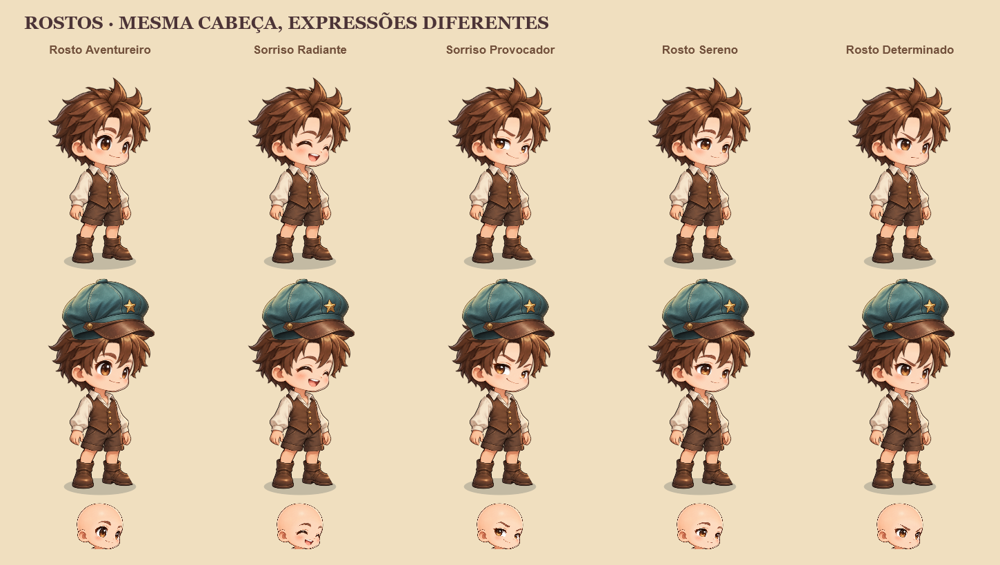

# Brasa Arena

Jogo de navegador de artilharia por turnos, com rua social, salas, terreno destrutível, equipamentos visuais e ferreiro. Cliente React + Canvas 2D; servidor TypeScript autoritativo com WebSocket, PostgreSQL e Redis.

## Checkpoint — rostos, 16/10/2026

Esta entrega fecha **somente os rostos**, conforme o último pedido. O jogo completo ainda está em desenvolvimento. Cinco expressões pintadas estão integradas aos ícones, à prévia, ao lobby e ao combate, usando a mesma cabeça universal; trocar a expressão não muda o contorno nem o encaixe do cabelo.



Para continuar: leia [estado e pendências](docs/implementation-status.md), [prompt de continuidade](docs/continuation-prompt.md) e [responsabilidades dos agentes](AGENTS.md). Cabelos, roupas, outros equipamentos e acabamento dos cenários **não estão concluídos**. As artes de corpo ainda incompletas permanecem desativadas, sem impedir os rostos.

## Executar com Docker

Requer Docker Engine/Desktop em modo Linux e Docker Compose v2. A imagem instala o runtime Node.js 24 e as dependências; não é necessário Node no computador para esta opção.

```powershell
docker compose up -d --build
docker compose ps
```

Abra [http://127.0.0.1:8097](http://127.0.0.1:8097). A primeira abertura cria um aventureiro convidado. O estado dos serviços pode ser consultado em [api/health](http://127.0.0.1:8097/api/health).

```powershell
docker compose logs -f server
docker compose down
```

O último comando encerra os serviços e preserva o volume `brasa-data`, que contém os perfis. A configuração padrão publica somente o navegador em `127.0.0.1:8097`; PostgreSQL e Redis permanecem na rede interna do Compose.

## Desenvolvimento

Requer também Node.js 24 e npm no computador. Use o servidor Docker com o cliente Vite:

```powershell
npm ci
docker compose -f compose.yaml -f compose.dev.yaml up -d --build server
npm run dev
```

Abra [http://127.0.0.1:5177](http://127.0.0.1:5177). O arquivo `compose.dev.yaml` publica o servidor em `127.0.0.1:4107`; o Vite encaminha `/api` e `/ws` para essa porta. Mudanças em `src/` têm atualização automática; mudanças em `server/` ou `shared/` exigem reconstruir o serviço `server` com o comando acima.

`npm run build` verifica TypeScript e gera `dist/`. `npm run dev:server` oferece reinício automático para um backend executado diretamente no computador, desde que `DATABASE_URL` e `REDIS_URL` estejam definidos e acessíveis. O Compose padrão não publica essas duas dependências no host, e os scripts npm não carregam `.env` automaticamente.

## Jogar

- Clique no chão da rua para caminhar e veja outros jogadores no mesmo canal. Entre na arena para criar ou encontrar salas 1×1 e 2×2; o líder pode adicionar bots.
- Na batalha, use setas para andar e mirar; segure e solte Espaço para disparar. `1`–`7` selecionam ferramentas e `P` passa o turno.
- `B` abre a mochila e `R` abre a arena. Clique, dê duplo clique ou arraste um item para experimentar; **Salvar** publica a combinação. **Restaurar** volta ao visual salvo. Slots atuais: arma, rosto completo, roupa completa, cabelo, chapéu, óculos, pulseira e bracelete. As duas joias não aparecem no corpo.
- Visite o ferreiro para fortalecer armas. Escolha a arma com duplo clique ou arraste, adicione pedras e confira a chance antes de confirmar. Apenas a aba de fortalecimento está disponível.

Há três armas com dano, gravidade, cratera e efeitos próprios, três mapas em desenvolvimento, chat de mundo/sala, treino com bot e progressão persistente. Os estágios visuais das armas são **+0–8**, **+9**, **+10–11** e **+12**; as auras automáticas começam em **+5**, evoluem em **+9** e chegam ao estágio completo em **+12**. Os cenários e suas limitações estão em [maps-checkpoint.md](docs/maps-checkpoint.md).

## Verificação

```powershell
npm run check
npm test
npm run build
```

Com o ambiente Docker completo aberto em `8097`:

```powershell
npm run test:integration
npm run test:load
```

Para testar pelo Vite:

```powershell
$env:BASE_URL = 'http://127.0.0.1:5177'
npm run test:integration
npm run test:load
Remove-Item Env:BASE_URL
```

A integração cria dois convidados `TEST-*`, exercita HTTP/WebSocket e executa verificações transacionais no PostgreSQL do serviço `server`. O teste transacional usa uma conta própria, removida ao terminar; os convidados de rede permanecem identificados como teste. A carga padrão abre 24 sessões, movimenta jogadores, mede 288 respostas de ping e verifica rejeição de comandos. `LOAD_CLIENTS` e `LOAD_ROUNDS` ajustam o ensaio; o resultado é JSON.

Com Vite rodando, `node scripts/verify-faces.mjs` verifica cinco pinturas diferentes e **zero diferenças de alfa** entre suas cabeças compostas; gera a prancha em `test-results/faces-contact-sheet.png`. `node scripts/smoke-browser.mjs` testa mochila, arraste, prévia local, salvamento, recarga e treino no navegador. Os scripts usam Microsoft Edge no Windows e Chromium do Playwright no Linux (instalação em `docs/cloud-handoff.md`); a verificação dos rostos depende dos módulos servidos pelo Vite. `test-results/` não é versionado.

## Limites atuais

Salas, batalhas e posições ficam na memória de um único processo. Reiniciar o servidor encerra partidas; Redis fornece limites HTTP e presença, sem distribuir simulações. O limite configurado de 1.000 conexões não é uma capacidade comprovada: o ensaio realizado cobre 24 conexões locais de lobby.

O acesso é de convidado, vinculado a um cookie com validade de 30 dias. Apagar ou perder esse cookie impede recuperar o perfil pela interface atual. Não há login com senha, comércio, guildas ou outras construções funcionais nesta etapa.

Estrutura, regras de fortalecimento, cores e decisões de segurança estão em [docs/architecture.md](docs/architecture.md). Os prompts das artes estão em [docs/art-prompts.md](docs/art-prompts.md) e [docs/apparel-prompts.md](docs/apparel-prompts.md).
